# Paper generation pipeline

Status: design for implementation, 7 November 2026. No backend paper-generation pipeline exists yet.

## Purpose and sources

This document turns the decided product behavior into an implementation sequence. The [standalone roadmap](../NIERA_QUESTION_PAPER_GENERATION_ROADMAP_STANDALONE.md) is the authority for product scope, user flow, and release gates. [architecture.md](architecture.md) records technical proposals, not proof that they were built. [curriculum-resolver.md](curriculum-resolver.md), [blueprint-engine.md](blueprint-engine.md), and [edge-cases.md](edge-cases.md) provide narrower design notes. The [progress tracker](todo-progress.md) records implementation work and evidence.

The product creates single-subject practice papers. Class and subject are the only required student inputs. Chapter/topic filters and advanced settings are optional. It does not administer tests, evaluate student responses, or grade them.

## Current baseline

The Next.js page collects a hardcoded class and subject, then displays a sample outline in local React state. It does not call a server, retrieve questions, save a draft, or export a paper. The Prisma schema has simplified `Curriculum`, `Topic`, `Question`, and `Blueprint` models, with no complete curriculum relationships, provenance, paper, or job records. The seed script refers to fields and a model absent from that schema. The two-question fixture contains duplicate MCQ options and a numerical question whose stated values conflict with its answer. Neither question is safe to treat as verified. No tests, migrations, measured benchmarks, or working generation service are present in this repository.

## End-to-end path

```mermaid
flowchart LR
  A[Class + subject; optional scope and settings] --> B[Resolve supported curriculum version]
  B --> C[Build and validate blueprint]
  C --> D[Estimate eligible bank supply]
  D --> E[Select verified questions by slot]
  E --> F{Unfilled slots?}
  F -- Yes, later phase --> G[Generate candidates for specific slots]
  G --> H[Validate independently and review]
  H --> I[Fill only approved slots]
  F -- No --> I
  I --> J[Validate whole paper]
  J --> K[Save structured draft and preview]
  K --> L[Edit or replace; revalidate]
  L --> J
  K --> M[Finalize immutable version]
  M --> N[Export paper, separate key and solutions]
```

Each arrow is a contract boundary. A failed stage returns a specific, actionable state. It never turns a partial set of questions into a successful paper.

## Stage contracts

| Stage | Input | Output | Required checks and failure behavior |
|---|---|---|---|
| 1. Normalize request | Class, subject, optional board/pattern, chapter/topic IDs, customization, request ID | Canonical request | Require class and subject. Resolve a visible default board/pattern only from a confirmed support matrix. Reject unsupported combinations and stale or foreign topic IDs. An empty topic list means full-subject scope. Preserve input for retry. |
| 2. Resolve curriculum | Canonical request | Pinned curriculum version; eligible chapters, topics, concepts, types, template | Verify class/subject/board match and that every selected scope ID belongs to this version. Pin its identity and version to the paper. Never replace a selected topic with another without explicit consent. |
| 3. Build blueprint | Resolved scope and supported template/settings | Explicit section and slot list, totals, duration, difficulty and coverage targets | Every slot has type, marks, allowed topic/concept scope, and required answer data. Counts and marks must sum exactly. Reject incompatible types or impossible totals with correction options. Do not derive exam weightage from a guess. |
| 4. Preflight supply | Blueprint and eligible, rights-cleared question inventory | Per-slot supply estimate and shortage list | Count only questions that meet curriculum, version, type, marks, status, and rights rules. Do not merely count all questions in a topic. A shortage is explicit; initial verified-bank release offers reduced count or broader scope, subject to user choice. AI gap filling comes later. |
| 5. Retrieve and select | Feasible blueprint slots and bank | Unique candidate assignment per slot | Use stable IDs. Filter by scope, type, marks, verified status, rights, and available answer/solution. Rank for coverage and variety. Prevent the same question or known equivalent from filling two slots. Record selection provenance. |
| 6. Fill gaps, later phase | Specific unfilled slots | Candidate questions in an unverified state | Request only missing slot types and concepts. Validate structure, scope, answer, distractors, clarity, similarity, display, and rights. Independent derivation or qualified review resolves quantitative keys. Reject or hold unresolved candidates. Never treat a second model response alone as independent proof. |
| 7. Assemble and validate | Assigned slots and pinned blueprint | Structured draft with ordered questions, options, keys, solutions, totals, and validation report | Check every slot, section count, marks sum, curriculum mapping, duplicates, answer mapping, source rights, and student-view answer separation. If any required check fails, return Needs changes or Needs review, with no finalization. |
| 8. Preview and revise | Valid draft version | Readable paper preview and controlled new draft version after edits | Show actual questions, scope, marks, and time. Replacement must fit its slot. Any wording, option, order, or answer change invalidates affected checks and triggers revalidation. A stale concurrent edit must not silently overwrite another version. |
| 9. Finalize | Fully valid draft and expected draft version | Immutable finalized paper version | Recheck the exact version being finalized. Save question and option order with the corresponding key and solutions. Repeated finalization of one logical request must return the same result or an explicit conflict, not a duplicate paper. |
| 10. Export and archive | Finalized version | Paper-only output, separate key/solutions, saved reference | All outputs come from the same immutable version. Verify page layout, math, glyphs, numbering, key mapping, and no answer leakage. Fail export rather than silently drop a question or broken symbol. Reopening must reconstruct the same paper. |

## Logical records and ownership

These are required data contracts, not a command to add a particular table or service immediately.

| Record | Core fields | Owner in pipeline |
|---|---|---|
| Support entry | Class, board/curriculum, subject, supported pattern, default template, available status | Request normalization |
| Curriculum version | Stable version ID/hash; chapters, topics, concepts and eligibility relationships | Resolver |
| Blueprint and slot | Pinned curriculum; section, type, marks, difficulty and allowed scope per slot; requested totals | Blueprint builder |
| Question version | Stable question ID and version; stem, type, options, key, solution, marks, concept mapping, verification state | Question bank |
| Provenance | Source/reference, reuse rights, reviewer decision, validation result and timestamps | Import and review |
| Generation job | Request/idempotency key, owner, state, progress, errors, retry data | Coordinator |
| Paper draft version | Owner, request, blueprint, ordered question-version references or snapshots, option order, key mapping, edit history, validation report | Assembly and editing |
| Finalized version | Immutable snapshot or immutable references sufficient to reproduce paper, key and solutions | Finalization |
| Export record | Finalized version ID, artifact type, outcome and integrity checks | Export |

The question's stable ID differs from its display number in a paper. A paper must pin a question version or snapshot; a later bank edit cannot alter an already finalized paper.

## State and recovery rules

Proposed logical job states: `REQUESTED → RESOLVING → BLUEPRINT_READY → SELECTING → VALIDATING → DRAFT_READY → FINALIZED`. `NEEDS_CHANGES`, `NEEDS_REVIEW`, and `FAILED_RETRYABLE` are explicit exits. Export is a separate operation on a finalized version. These names are a design proposal; finalize the exact API and persistence model before implementation.

- A request ID prevents duplicate work or publication on retry. Save each durable transition and its input version before reporting it complete.
- A retry resumes from durable state or restarts safely with the same request ID. It cannot claim a partial paper is ready.
- Edits use an expected draft version. If another edit won first, return a conflict and let the user reload or compare.
- Finalization checks the exact draft version and all quality gates in one atomic decision. The finalized content is immutable.
- A database or model timeout leaves the request and accepted work recoverable. The user sees the failed stage and available next action.
- Source rights are checked when importing/selecting questions and again before distributable export. Do not hold a database row lock for the entire PDF render; settle the rights and snapshot contract before choosing a transaction strategy.

## Validation boundaries

Question-level checks cover schema, syllabus scope, answer correctness, distractors, clarity and difficulty estimate, duplicates, notation, and reviewer status. Paper-level checks cover slot completion, section sequence, counts, total marks, permitted coverage, source rights, and separation of student paper from keys. Output-level checks cover rendering and exact key/option alignment. A passed schema check is not evidence that a scientific answer is correct.

The initial vertical slice should use a small, independently reviewed bank and deterministic selection. AI generation is enabled only after that slice can produce and validate a complete paper. Keep the validation policy the same for bank and generated content where applicable, with additional independent checks for generated answers.

## Architecture analysis and conflicts to settle

1. The roadmap intentionally leaves technology choices out; the README proposes Next.js, tRPC, Prisma/PostgreSQL, Playwright/KaTeX, AI SDK, BullMQ/Redis, and auth. Only Next.js, React, TypeScript, a Prisma schema, and some installed packages are visible as working code. Treat other components as proposals until implemented and verified.
2. `architecture.md` labels v2.1 fixes as applied and gives latency and scale figures. The repository has no cache, similarity index, renderer, benchmark, or load test supporting those figures. Record measurements only after a runnable pipeline exists.
3. The blueprint example in `blueprint-engine.md` specifies 10 one-mark MCQs and 5 three-mark numericals but claims 40 marks; those rows total 25. Repair example fixtures before using them as contracts.
4. The architecture note's PDF fallback may “skip block gracefully.” Skipping a question would violate blueprint completeness and export integrity. A failed render must block that export or use a verified equivalent rendering of the same content.
5. The architecture note proposes locking selected questions during PDF generation with `FOR UPDATE SKIP LOCKED` and a `for_export` flag. The current schema has no such flag, and a lock held across rendering would tie up database transactions. Define immutable paper content and rights policy first, then design a short atomic check if needed.
6. The schema, seed, fixture, and UI disagree on curriculum coverage and question validity. Confirm one supported slice, repair seed/schema alignment, and independently review content before claiming Phase 0 complete.
7. The architecture note calls a “32-char SHA-256” hash. A standard SHA-256 hex digest has 64 characters. Decide whether this means a truncated digest, another encoding, or a different identifier; do not rely on the current wording as an integrity guarantee.

## Build order and acceptance

Follow the phase gates in the roadmap: confirm scope and rights; define shared contracts and a real fixture preview; build the deterministic blueprint; import and select verified questions; then add controlled AI candidates, editing/versioning, export/archive, and reliability work. The first useful end-to-end result is **one supported class and subject producing a complete, correct, retrieval-only draft with actual questions**. Its evidence must include a reviewed fixture, passing structural and answer checks, and a browser preview showing those same questions. Detailed tasks and current status are in [todo-progress.md](todo-progress.md).
